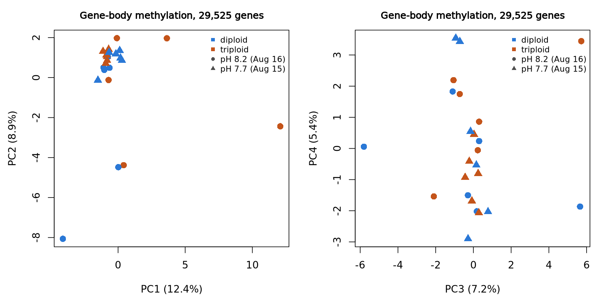

# ROBERTS2022_PH_PLOIDY_WGBS: sample structure and gene-level differential methylation

Gill (ctenidia) WGBS of 24 adult Pacific oysters: diploid and triploid, held
at pH 8.2 or 7.7, 6 per group (PRJNA682817). This analysis asks whether gene
methylation differs with ploidy, with pH, or with their combination.

**Short answer: very little does.** Of ~29,500 gene bodies, 7 differ by ploidy
(4 of them robust to dropping two outlying libraries) and none by pH. The
sample structure is dominated by individual variation, not by either factor.

## Data and methods

- **Input**: the study's committed gene tables (`data/studies/ROBERTS2022_PH_PLOIDY_WGBS/genes/`),
  built with the C/T SNP mask `GCF_963853765.1.snpmask.v1` (628,253 CpGs on
  SNPs left out; [docs/snp_mask.md](../../docs/snp_mask.md)). Results here were
  computed from the tables at commit `490d48d` (PR #45).
- **Genes tested**: in each region (gene body; promoter, 1 kb upstream to
  200 bp downstream of the TSS), genes with ≥5 covered CpGs and ≥10 calls in
  **every** library: 29,525 gene bodies and 25,537 promoters of 33,331 genes.
- **Sample structure**: PCA of gene-body methylation (proportion methylated,
  centred) over the 29,525 genes; each PC regressed on ploidy + pH.
- **Tests**: DSS 2.58 beta-binomial regression (`DMLfit.multiFactor`, Wald
  tests; Park & Wu 2016), one "site" per gene holding its summed methylated and
  total calls. Additive model `~ ploidy + pH` for the two main effects; full
  model `~ ploidy * pH` for the interaction. Benjamini–Hochberg FDR within each
  test and region; significant at FDR < 0.05. Effect sizes are differences of
  group means of per-library methylation, in percentage points.
- **Sensitivity**: the tests repeated without libraries more than 3 SD from
  the mean on PC1 or PC2 (SRR13207055, SRR13207071).
- **Reproduce**: `analysis/ROBERTS2022_PH_PLOIDY_WGBS/run.sh` (the pinned DSS
  container; ~1 min).

## Sample structure

| PC | Variance | p (ploidy) | p (pH + date) |
|---|---|---|---|
| PC1 | 12.4% | 0.19 | 0.32 |
| PC2 | 8.9% | 0.41 | 0.04 |
| PC3 | 7.2% | 0.69 | 0.81 |
| PC4 | 5.5% | 0.80 | 0.49 |
| PC5 | 5.0% | 0.61 | 0.45 |

20 of 24 libraries form one cluster. PC1 and PC2 are driven by four libraries,
all from pH 8.2 animals (SRR13207055, SRR13207071, SRR13207051, SRR13207065).
Their QC is unremarkable (mapping 29.7–30.1%, conversion 98.6–98.7%), so
this looks like individual variation. Sex is not recorded and could be part of
it. Neither PC separates ploidy; PC2's weak pH association (p = 0.04) comes
from these outliers.

## Differential methylation (FDR < 0.05)

| Test | Gene bodies | Without outliers | Promoters | Without outliers |
|---|---|---|---|---|
| Ploidy (triploid vs diploid) | 7 (6 higher in triploids) | 5 (4 shared) | 1 | 3 (0 shared) |
| pH 7.7 vs 8.2 (and collection day) | 0 | 0 | 3 (all higher at 7.7) | 2 (1 shared) |
| Ploidy × pH interaction | 7 | 6 (2 shared) | 2 | 1 (1 shared) |

Gene-body ploidy hits that hold without the outliers:

| Gene | Description | Mean | Diploid | Triploid | Δ (pp) | FDR |
|---|---|---|---|---|---|---|
| LOC136276344 | tigger transposable element-derived protein 4-like | 6.0 | 0.9 | 11.2 | +10.3 | 6e-4 |
| LOC105335458 | scm-like with four MBT domains protein 1 | 23.2 | 20.7 | 25.7 | +5.0 | 1e-3 |
| LOC136275703 | solute carrier family 49 member 4-like | 26.8 | 34.0 | 19.6 | −14.4 | 7e-3 |
| LOC105331697 | pre-rRNA-processing protein TSR1 homolog | 35.3 | 31.2 | 39.5 | +8.4 | 7e-3 |

The one robust pH promoter hit, LOC136273544 (uncharacterized), is 23 points
higher at pH 7.7 in both ploidies (32.8→56.0 diploid, 29.4→52.1 triploid;
FDR 2e-5). Full tables: `results/gene_body_tests.tsv.gz`,
`results/promoter_tests.tsv.gz`, and `results/sensitivity/`.

**Calibration** ([histograms](results/pvalue_histograms.png)). Gene-body ploidy
and pH tests are well calibrated (λ 1.03, 1.01) with only a slight excess of
small p values. The gene-body interaction test is inflated (λ 1.16), and that
falls to 1.04 without the two outliers, which sit in the pH 8.2 cells. Promoter
tests are conservative (λ ≈ 0.87): most promoters are near 0% methylated, where
the beta-binomial has little to work with.

## What this does and does not show

- **Ploidy changes the methylation of few genes.** Of the 5,252 tested gene
  bodies at ≥50% methylation, 234 differ between ploidies by ≥5 percentage points
  and 16 by ≥10; pH gives 211 and 20. The smallest ploidy difference that
  reached significance was 5.0 points. With 12 animals per ploidy and ~5 calls
  per CpG, smaller or CpG-local differences would be missed.
- **Ploidy is confounded with origin.** The deposit does not say where the
  diploids and triploids came from, so a difference could reflect family or
  broodstock rather than ploidy. A triploid's value also averages three alleles.
  The SNP mask removes common C/T SNPs but not private ones.
- **pH is confounded with collection day.** Every pH 7.7 animal was sampled on
  2020-08-15 and every pH 8.2 animal on 2020-08-16, so the "pH" term is pH and
  day together. The lack of gene-body pH effects means neither had a broad effect.
- **The interaction hits are fragile.** Five of seven depend on the two outlying
  libraries. Treat them as leads at most.
- **Descriptive, single study.** Nothing here is replicated, and nothing is
  tied to expression (no RNA-seq for these animals).
